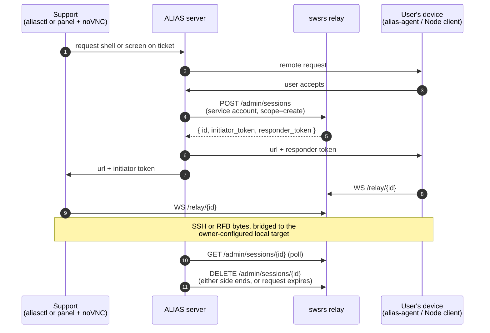

# ALIAS

**Product:** [ALIAS](https://getalias.support) (Anonymous, Live,
In-context Assistance Service), a support desk built into products.

**swsrs role:** the relay behind the
[remote assistance](https://getalias.support/features#remote-assistance)
feature. Each ALIAS deployment runs its own unmodified swsrs relay.

**Status:** in production since ALIAS 0.3.0.

## The problem

ALIAS users report issues from inside an app or game, with a
screenshot, context fields and telemetry. They have no account and no
email. ALIAS identifies them by an id and secret it generates itself.
Support answers from a web panel, and the answer shows up in the app.

Sometimes an answer isn't enough and support needs to look at the
device: open a shell, or see the screen. The device is usually behind
NAT, and nobody wants a standing tunnel, an inbound port, or an
account with a third-party remote-desktop service just to get there.

## The shape

Support asks from a ticket to open a shell (SSH) or see the screen
(VNC). Nothing connects until the user accepts the request on the
device.

- **Initiator (support):**
  - Shell: `aliasctl` on the support person's machine. It listens on a
    local port, or acts as an ssh `ProxyCommand` over stdio, and the
    person's own `ssh` connects through it. It uses `swsrs.Dial` from
    the Go SDK.
  - Screen: the ALIAS panel in a browser runs noVNC directly on the
    relay's WebSocket.
- **Responder (the user's device):** one of
  - `alias-agent`, a Go binary for headless machines, using
    `swsrs.Accept`;
  - the ALIAS Node client (`alias-support/remote`, for example in an
    Electron main process);
  - an app's own bridge.

  On accept, the responder bridges the session to a local target that
  the device's owner configured, such as `127.0.0.1:22` or
  `127.0.0.1:5900`. Support can't choose the target.
- **Minting:** the ALIAS server creates sessions on the swsrs admin
  API. The relay validates JWTs from the same Keycloak realm the ALIAS
  panel signs in with.

What flows through the tunnel is raw TCP: SSH or RFB (VNC). The relay
doesn't inspect it.

## Which swsrs parts

| Part | Used | Where |
|---|---|---|
| Relay server | Yes, unmodified, one per deployment | |
| Go SDK `pkg/client` (v0.4.0) | Yes | `cmd/alias-agent` (`Accept`), `cmd/aliasctl` (`Dial`) |
| Admin API | Yes, over plain HTTP, no SDK | ALIAS server |
| TypeScript SDK | No | Browser (noVNC) and Node sides use their own WebSocket code |
| CLI | No | |

## Auth and session options

The ALIAS server gets tokens with an OIDC service account (client
credentials). The token endpoint comes from the issuer's discovery
document. The account holds `swsrs:session:create`,
`swsrs:session:read` and `swsrs:session:delete`.

The user and support never talk to the relay's IdP for the tunnel
itself. Each side gets the session URL and its slot token from ALIAS,
and only after the device accepts. This is the
[two-plane split](/guide/auth) applied directly: the party that mints
sessions has an IdP identity, the peers don't need one.

Each accepted request creates one session with:

| Option | Value |
|---|---|
| `ttl_seconds` | the product's remote "minutes" setting, default 30 minutes |
| `peer_wait_seconds` | 120 |
| `label` | `alias:<product>:<ticket>:<request id>` |
| `single_attach` | `true` |

The label ties a relay session back to a ticket and request. The relay
has no per-user identity on the data plane, by design, so that mapping
lives in ALIAS.

The relay's `SWSRS_ALLOWED_ORIGINS` lists the panel's hosts, because
the browser connects to the relay directly.

## Why swsrs

- **Both peers dial out.** The device needs no inbound port and works
  behind NAT.
- **No standing tunnel.** Sessions are short-lived, single-use and
  minted per request. Before a request is accepted, there's nothing
  listening and nothing connected. That keeps the consent model on the
  device simple.
- **Self-hostable, small, OIDC on the admin plane.** Each deployment
  runs its own relay. Self-hosted ALIAS installs run theirs (see
  [ALIAS self-hosting notes](https://getalias.support/guide/self-hosting/deploy#remote-assistance)).

The alternatives each needed something ALIAS wanted to avoid. A VPN or reverse SSH needs standing connections or inbound
access. A commercial remote-desktop service needs accounts on a third
party.

## Rough edges

Stated plainly, because they apply to anyone doing the same thing:

- **The token is in the URL for browser peers.** Browsers can't set
  headers on a WebSocket upgrade, so the panel's VNC connection sends
  the slot token as `?token=`. It is short-lived and single-attach,
  but it can end up in proxy access logs.
- **VNC isn't end-to-end encrypted.** SSH is end to end, and the
  device's own sshd sign-in still applies. RFB is only protected by
  TLS to the relay, so the relay sees it in the clear. ALIAS tells
  users to run the relay themselves for that reason.
- **Every panel host must be an allowed origin.** Tenant hosts under a
  wildcard needed a wildcard entry in `SWSRS_ALLOWED_ORIGINS`.
- **No TypeScript SDK use.** noVNC wants a raw WebSocket, and the Node
  side was written by hand over WebSocket too.
