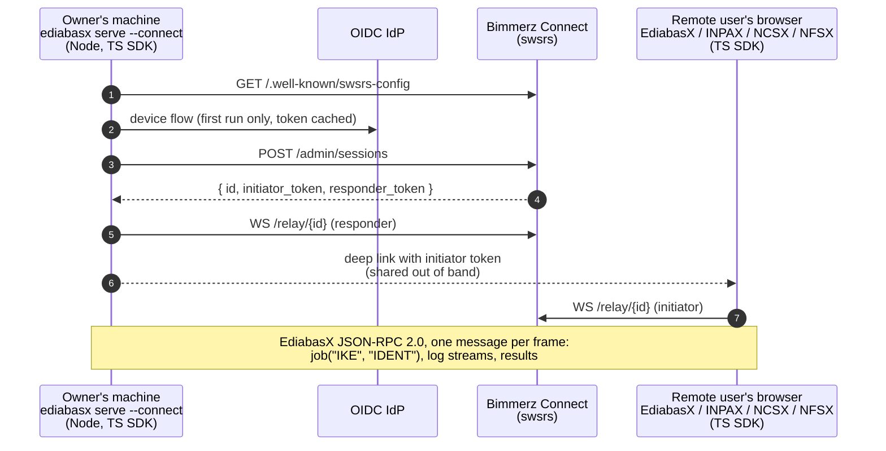

# Bimmerz Connect

**Product:** [bimmerz.app](https://bimmerz.app), open-source
replacements for BMW's diagnostic, coding, and documentation software
(EdiabasX, INPAX, NCSX, NFSX and others).

**Relay deployment:** [connect.bimmerz.app](https://connect.bimmerz.app),
a self-hosted swsrs instance.

**Status:** in production since EdiabasX 0.6.0.

## The problem

BMW diagnostics needs a cable plugged into the car and a machine with
the cable driver and the ECU description files (SGBDs). The person
sitting at that machine is often not the person who knows what to do
with it. The car is in someone's garage, behind a home router, and
neither side wants to set up port forwarding or a VPN.

EdiabasX already had a client/server split: `ediabasx serve` wraps the
EDIABAS runtime behind a JSON-RPC API over WebSocket, and the web apps
can drive it remotely. On a LAN that's a plain `ws://host:port`.
Bimmerz Connect is the same thing across NAT.

## The shape

- **Responder: the machine with the cable.** The owner runs the
  EdiabasX CLI (Node) with `--connect`:

  ```bash
  ediabasx serve --connect \
    --sgbd-path ~/ECU --interface kdcan --serial-port /dev/cu.usbserial-XXXX
  ```

  The CLI creates the session itself, attaches as the responder with
  `accept()` from the swsrs TypeScript SDK, and hands the socket to
  the EdiabasX server.
- **Initiator: a browser.** The remote user opens one of the web apps
  (EdiabasX, INPAX, NCSX, NFSX), which calls `dial()` from the same
  SDK with the initiator token.
- **Hand-over:** the CLI prints the initiator token and a deep link
  (`https://ediabasx.bimmerz.app?connect=<token>`). The owner shares
  it over whatever channel they already use. The remote user clicks
  it, or pastes the token into the web app's Bimmerz Connect dialog.



The car side is plain hardware: ECU, OBD-II, a K+DCAN or similar cable
to the owner's machine. None of that crosses the relay. What crosses
it is EdiabasX JSON-RPC at the level of diagnostic jobs, not raw bus
frames, and the relay doesn't inspect it.

## Which swsrs parts

| Part | Used | Where |
|---|---|---|
| Relay server | Yes | `connect.bimmerz.app` |
| TypeScript SDK | Yes, both peers | `ediabasx` CLI (`accept`), EdiabasX / INPAX / NCSX / NFSX web apps (`dial`) |
| `discoverConfig`, `deviceLogin`, `FileTokenStore` | Yes | `ediabasx` CLI, for minting |
| Go SDK | No | |
| swsrs CLI | No | |

The same SDK runs in Node on the cable side and in the browser on the
remote side, with no runtime dependencies in either.

## Auth

There is no Bimmerz backend in the path. The owner running
`ediabasx serve --connect` is the one who mints the session:

1. The CLI reads the relay's [discovery document](/reference/discovery)
   to find the IdP. No issuer, client ID or scopes are configured in
   EdiabasX.
2. On first run it runs OAuth device flow: it prints a code and a URL,
   the owner signs in from any browser. The token is cached with
   `FileTokenStore`. On a 401 it clears the cache and logs in again.
3. It calls `createSession()` with the server defaults.

The remote user never signs in to anything. The initiator token in the
link is all they need. This is the [two-plane split](/guide/auth) in
its simplest form: one party with an IdP identity mints, and the other
party only holds a slot token.

## Why swsrs

- **Both sides dial out.** The owner's machine needs no open port, and
  the remote user is in a browser.
- **The protocol didn't change.** EdiabasX's JSON-RPC over WebSocket
  runs the same over the relay as on a LAN. The integration point was
  a pre-connected socket: `EdiabasServer.attachStandardWebSocket()` on
  one side and `EdiabasClient`'s `socket` option on the other.
- **One SDK for Node and browser.** Four web apps and the CLI share
  the same client.
- **The data path is Bimmerz's.** ECU data stays on infrastructure the
  project controls.

## Rough edges

- **No reconnect.** If the socket drops, the CLI exits and the web apps
  ask for a fresh token. swsrs has no transparent reconnect, so
  recovery means starting a new session.
- **Manual hand-over.** The link is shared by hand. That's fine for
  "help me with my car", and it's also the reason no backend is
  needed.
